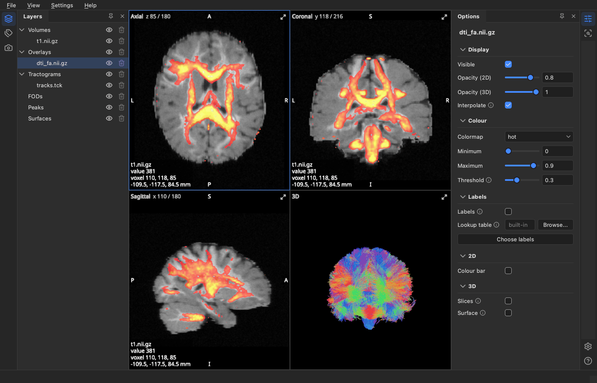

# Getting started

BrainViewer, Larmor's viewer, shows brain images, tractograms, fibre orientation distributions (FODs), peaks and
cortical surfaces in three 2D views and a 3D view. This guide shows how to open files, how to install the viewer on
its own, and how its window is laid out.



The pictures in these guides show the simulated brain of the ISMRM 2015 Tractography Challenge (Maier-Hein et
al., Nature Communications 8 (2017) 1349; https://doi.org/10.5281/zenodo.572345, CC BY 4.0): its T1-like image,
and the DTI maps, FODs, peaks and tractogram that Larmor made from its diffusion data. The data has no FreeSurfer
surfaces or parcellation, so the tissue labels and surfaces shown were made from simple masks of the T1-like
image.

## Opening files

The viewer sorts what it shows into six categories: volumes, overlays, tractograms, FODs, peaks and surfaces.
Each way of opening files decides which category they go into.

- From the command line, give each file after the option of its category:
  `lar bv -v t1.nii.gz -o mask.nii.gz --tracts tracts.tck -f fod.mif -p peaks.nii.gz`. The options are `-v` for
  volumes, `-o` for overlays, `--tracts` for tractograms, `-f` for FODs, `-p` for peaks and `--surfaces` for
  surfaces, and you can repeat an option to open several files. Files given without an option, as in
  `lar bv t1.nii.gz tracts.tck`, are sorted by their names: tractograms go to Tractograms, a session
  (`.lar.json`) is opened, other `.json` files (such as BIDS sidecars) are skipped, and everything else goes to
  Volumes.
- From the file manager, once the launcher is added (see below), open a file with BrainViewer or, on macOS, drop
  it on the viewer's icon in the Dock.
- With **File > Open** (Ctrl+O, Cmd+O on macOS), choose the files. The file type you pick at the bottom of the
  dialog sets their category.
- Drag files onto a category's row in Layers, or onto one of its items. The rows that would take the files are
  highlighted while you drag, and files the category cannot read are refused.
- From Python, run `from larmor.viewer import view`, then `view(volumes="t1.nii.gz", tracts="tracts.tck")`.

Images are read from NIfTI (`.nii`, `.nii.gz`) and MRtrix (`.mif`, `.mif.gz`, `.mih`) files, and tractograms from
`.tck`, `.trk`, `.vtk` and `.fib` files, gzipped or not. Files are read in the background, and the status bar
shows the progress with a Cancel button. A tractogram with more streamlines than the read limit (1,000,000 by
default, see [Settings](09-settings.md)) is reduced to a random subset of that size, and the same file always
gives the same subset.

## Installing it for the viewer only

If you only want the viewer, install Larmor as a tool of its own with [uv](https://docs.astral.sh/uv/). uv also
installs the Python version Larmor needs and puts the `lar` command on the PATH:

```bash
uv tool install "larmor-dmri[viewer]"
```

`pipx install "larmor-dmri[viewer]"` works too, as does `pip install "larmor-dmri[viewer]"` in an environment
of your own. Until Larmor is on PyPI, install it from a clone of its repository by running the command below in
the clone. This compiles Larmor's C++ module, so it needs a C++ compiler, which you get on macOS with
`xcode-select --install`.

```bash
uv tool install ".[viewer]"
```

## Starting it from the desktop

The launcher lets you start the viewer from the desktop and open files with it from the file manager. Add it
once, from a terminal:

```bash
lar bv --install-launcher
```

The launcher starts the Larmor install that ran this command, so run the command again after you move or
reinstall Larmor. What it adds depends on the system.

- On macOS it adds `~/Applications/BrainViewer.app`, which shows in Launchpad and Spotlight. To keep it in the
  Dock, use **Options > Keep in Dock**. Finder's **Open With** offers it for `.nii`, `.nii.gz`, `.mif`, `.mih`,
  `.tck` and `.trk` files, and, because macOS matches only the last part of a file name, for every `.gz` file
  too.
- On Linux it adds a BrainViewer entry to the application menu
  (`~/.local/share/applications/larmor.brainviewer.desktop`), its icon, and the file types it opens, so that the
  file manager offers it for NIfTI, MRtrix, `.tck` and `.trk` files. You can pin it to the dock or taskbar from
  the menu.
- On Windows it adds a BrainViewer shortcut to the Start menu, which you can pin to Start or the taskbar from its
  right-click menu. Files dropped on the shortcut open in the viewer, but Explorer's **Open With** does not list
  it.

`.vtk` and `.fib` tractograms are not registered with the file manager, because many programs use `.vtk`; open
them from the command line or with File > Open.

The launcher never writes over a file it did not add. If another file is already in its place, such as a
`BrainViewer.app` from another program, it stops and names that file, so you can move or remove it first.

`lar bv --uninstall-launcher` removes exactly what was added, lists each file it removes, and removes the folders
it made once they are empty. To remove the viewer itself, remove the launcher first and then the tool:

```bash
lar bv --uninstall-launcher
uv tool uninstall larmor-dmri
```

If you installed with pipx, use `pipx uninstall larmor-dmri` instead. Only the viewer's settings are then left,
in `~/Library/Application Support/larmor` (macOS), `~/.config/larmor` (Linux) or `%APPDATA%\larmor` (Windows).
Delete that folder too to leave nothing behind.

## Panels

Panels are the parts of the window beside the views, such as Layers and Options. A stripe of icons on each edge
of the window opens and closes them. The left stripe holds Layers (Ctrl+1), Labels (Ctrl+3), Screenshots
(Ctrl+Shift+S) and Phantom (Ctrl+5). The right stripe holds Options (Ctrl+2), Inspect FOD (Ctrl+4), Signal
breakdown (Ctrl+6), Settings (Ctrl+,) and Help (F1). On macOS, Cmd takes the place of Ctrl. Click an icon to open
its panel and click it again to close it; the views take up the room the panels leave. **Ctrl+0** hides all the
panels and brings them back. Hover over an icon to see its name and key; View > Panels lists them too.

The pin at the top of a panel makes it auto-hide: it then slides out over the views when you click its icon, and
slides back when you click the views. Click the pin again to keep the panel beside the views. You can also drag a
panel by its title to the other side of the window, or above or below another panel. The viewer remembers which
panels are open, where they are and how large they are. View > Panels > Reset Layout puts every panel back where
it was at first start. After an update that changes the panels, they start once in their first places.

## Layers and Options

**Layers**, on the left, lists the loaded items (each file or object you opened) by category: Volumes,
Overlays, Tractograms, FODs, Peaks and Surfaces. Each row has an eye, which shows or hides the item, and a cross,
which removes it. A category's eye and cross act on all its items.

**Options**, on the right, shows the options of what is selected in Layers. Select an item to change that item
alone, or select a category to change all its items at once; where the items differ, a field shows "mixed".
Double-click an item or a category to bring up Options when it is closed or auto-hidden. A single click also
opens Options, but only while no other panel is open on the right.

The options come in sections, such as Display, Colour and 3D. Click a section's title to fold it away; it then
stays folded for that kind of item. Options marked (2D) or (3D), or in a 2D or 3D section, apply to those views
only.

## The four views

The axial, coronal and sagittal views each show a slice through the crosshair, and the 3D view shows the whole
scene in 3D. [The 2D views](02-2d-views.md) and [The 3D view](06-3d-view.md) explain how to use them, and Help >
Shortcuts lists every key and mouse control.

## Agents

An agent, such as Claude Code, can drive the viewer through the Model Context Protocol (MCP). The agent then
loads files, changes options, moves the cursor and takes screenshots while you watch. [Driving the viewer from an
agent](12-agents.md) shows how to connect one.
