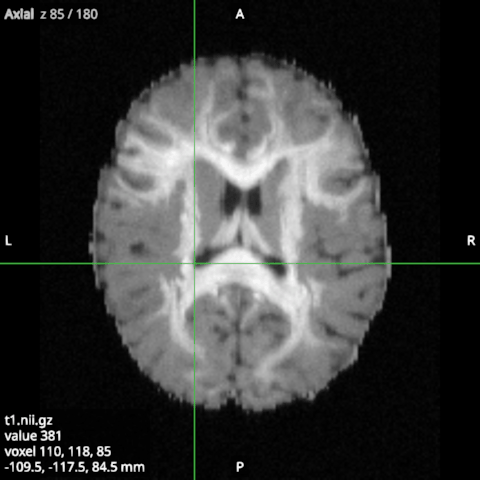

# The 2D views

The axial, coronal and sagittal views each show one slice through the crosshair. Moving the crosshair in one
view moves the slices of the others.

## Moving around

| Mouse or key | Does |
|---|---|
| Click or drag, with the Cursor tool | Moves the crosshair there, and selects the view |
| Scroll, or Up and Down | Next or previous slice, one voxel of the main volume at a time |
| Ctrl + scroll, or pinch | Zooms about the pointer |
| Ctrl++ and Ctrl+- | Zoom in and out about the crosshair |
| Ctrl + drag | Pans |
| R | Shows the whole view again (zoom 1, centred) |

Ctrl is Cmd on macOS. The keys act on the selected view, which has a thin frame in the accent colour.

## Pointer tools

What a click and a drag do in the views depends on the pointer tool, which you choose with a key. Whatever the
tool, Ctrl+drag pans and the wheel steps the slice, and a press on the outline or the centre of a region, or on
the edge of a detail window's box, takes that instead of the tool.

| Key | Tool | A click or a drag in a 2D view |
|---|---|---|
| V | Cursor | Moves the crosshair, as above |
| O | Sphere | Places a sphere region at the click; a drag from the centre sets its radius (Dissect only) |
| B | Box | Draws a box region over the rectangle dragged, as deep as a tractogram's slab (Dissect only) |
| Z | Zoom box | Drags a rectangle that opens in a detail window |
| N | Draw bundle | Draws a phantom bundle, in the Simulate workspace (see [Phantoms](15-phantoms.md)) |

Escape returns to the Cursor tool once it has done its other jobs, such as stopping a bundle being drawn. Regions
and their handles are explained in [Tractograms](05-tractograms.md). The zoom box snaps to the voxels of the main
volume (of the FOD when no volume is loaded) while you drag, and the status bar gives its size in voxels and in mm;
Shift keeps it square and Alt grows it from the point pressed. When you let go, the rectangle opens in a detail
window (see [FOD glyphs](07-fod-glyphs.md)) and stays outlined in the view, and dragging its edge moves the detail.
A right click in a view offers to add a sphere or box region at that point, or to open a 12 x 12 voxel zoom box
around it.

## The crosshair and the readout

The top-left corner names the view and the slice of the main volume that it shows. The main volume is the image
that sets the slices (see [Volumes and overlays](03-volumes-and-overlays.md)). Slices are counted from 0, as voxels
are, so "Axial z 124 / 260" is slice 124 of 260 along z.

The bottom-left corner holds the readout. It gives the main volume's name, its value at the crosshair, the voxel
(with the volume index last for a 4D image) and the position in mm. The letters at the edges of the view give the
orientation: R and L, A and P, S and I.

X shows or hides the crosshair, and I shows or hides the text, the letters and the colour bars. Both are also in
the View menu.

## RAS and LAS

By default the views follow the neurological convention (RAS), which puts the subject's right on the right of
the screen. The radiological convention (LAS) puts it on the left in the axial and coronal views. Change it with
Display convention in [Settings](09-settings.md).

## One view at a time

The button in a view's top-right corner, or a double click in the view, makes that view fill the window. Do it
again to show all four views. The keys A, C, S and 3 do the same for the axial, coronal, sagittal and 3D views.
