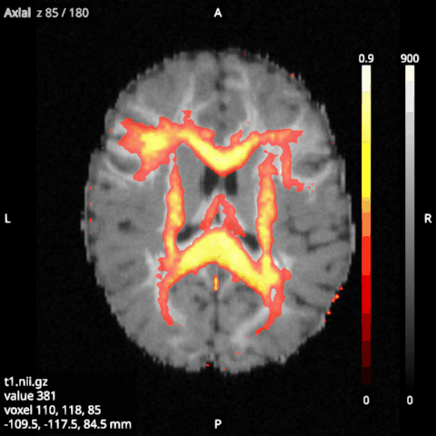
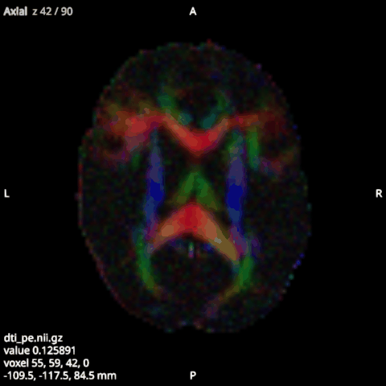

# Volumes and overlays

A **volume** is an image to look at, such as a T1 or an FA map. One volume is shown at a time, the **main
volume**, which sets the slices of the 2D views and the value in the readout. A volume you open becomes the main
volume, and showing another volume with its eye makes that one the main volume and hides the others.

An **overlay** is an image drawn over the volume, such as a map, a mask or a [parcellation](04-parcellations.md).
Any number of overlays can be shown at once.

## Their options

Volumes and overlays share most of their options, which you set in the Options panel.

- **Colormap** is one of gray, hot, viridis, inferno, magma, plasma, cividis, jet, bone, cool, gray_r (white to
  black) or blue_dark_red (blue below the middle of the range, dark at it, red above).
- **Minimum** and **Maximum** are the values the colormap spans. They start at the image's range.
- **Threshold**, for overlays only, makes values at or below it transparent, so only the part of a map above it
  shows. It starts at the image's minimum, so a mask's zeros are transparent.
- **Opacity (2D)** and **Opacity (3D)** set how much the image hides what is under it.
- **Interpolate** draws the slices smooth (trilinear) or blocky (nearest voxel).
- **Colour bar** shows a bar of the colormap, with its minimum and maximum, at the right edge of the 2D views.
- **Slices** and **Surface**, under 3D, choose what the image shows in the [3D view](06-3d-view.md).

## 4D images

A 4D image, such as a diffusion-weighted series, shows one of its volumes at a time, chosen with **Volume
index**. This option belongs to each item, not to its category. The Left and Right arrow keys step through the
volumes of the selected 4D image or, when no 4D image is selected, of the main volume. The minimum and maximum
start at the range of the whole series, so all its volumes are shown on one scale.

## DTI colour maps

A DTI colour map shows the direction of the diffusion tensor's principal eigenvector in each voxel as a colour.
Red, green and blue are the size of the vector's x, y and z components, that is, left to right, front to back and
up and down. To show an image of 3 volumes this way, such as the principal eigenvector that `lar dti` writes
(`out_pe.nii.gz`), tick **DTI colours** in its options. The field shows only for an image of 3 volumes.

A unit eigenvector is drawn fully bright. To weight it by FA, load the FA image (`out_fa.nii.gz`) as well and
choose it in **Modulate by**, which lists the loaded 3D images on the same grid. Its values, clipped to 0 to 1,
then scale the colours. While DTI colours are on, the colormap, range, threshold and colour bar do not apply and
are greyed out.

