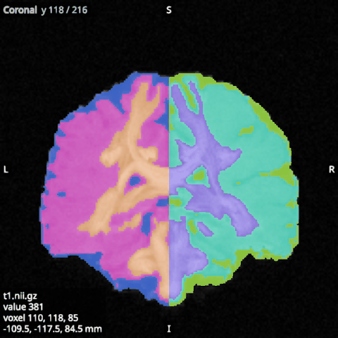

# Parcellations

A parcellation, such as an atlas or FreeSurfer's `aparc+aseg`, is an image of whole numbers, one per region,
with 0 outside every region. Open it as an **overlay** and tick **Labels** in its options. Each region then gets
its own colour, and 0 is transparent, so the anatomy shows around the regions.

## Colours

Without a lookup table, the regions get built-in colours spread around the colour wheel, so that neighbouring
numbers look different.

A **lookup table** is a text file that names each region and gives its colour. To use one, choose its file with
Browse... beside the Lookup table option, or type its path; clear the field to go back to the built-in colours.
The viewer reads two layouts, FreeSurfer's `index name R G B A`, as in `FreeSurferColorLUT.txt`, and MRtrix's
`index short-name long-name R G B A`, as in `fs_default.txt`. Colours are from 0 to 255, and the last column is
ignored. A region missing from the table keeps its built-in colour.

An image with more than 8192 distinct values cannot be shown as labels. It is drawn through its colormap
instead, and a warning is written to the log.

## Labels in 3D

In the 3D view, the labels you choose are drawn as surfaces in their colours. To choose them, press **Choose
labels** in the overlay's options. The inspector's Cursor tab then lists the labels in the image with their
numbers, names and colours; tick the ones to show. To find labels, type a number or part of a name in
the search field, then use **All** or **None** to tick or untick every label it finds.

No labels are shown at first, so a parcellation takes no time to draw in 3D until you choose some. Each label's
surface is computed in the background the first time it is shown.

The list shows the overlay selected in the scene tree while it is shown as labels, and keeps showing it while
another kind of item is selected. It keeps its search and scroll position while you look at another tab. In the
overlay's options,
**Surface** (under 3D) turns all the label surfaces off and on again, and **Opacity (3D)** makes them see-through.
Neither affects the slices.
