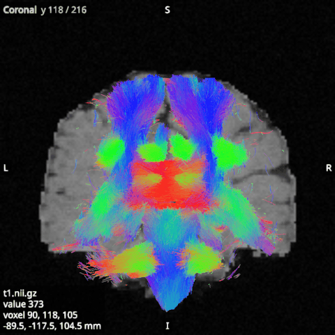
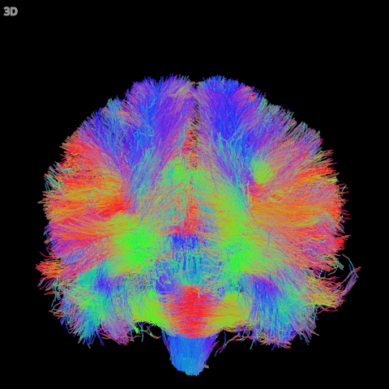
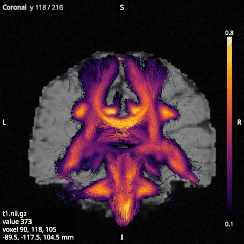
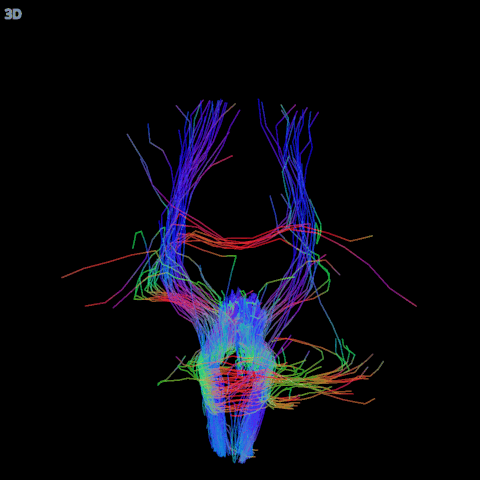

# Tractograms

A tractogram is a set of streamlines, each a line of points along a fibre path. The viewer draws it as lines in
the 2D views, and as lines or tubes in the 3D view.

## Their options

- **Colouring** sets how the streamlines are coloured. **direction** colours them by their direction (red left
  to right, green front to back, blue up and down), **single_colour** uses the Colour option, **per_tractogram**
  gives each tractogram a different colour, and **by_value** colours them by a value per point (see below).
- **Subset (%)** is the share of the streamlines drawn, taken at random, the same ones each time. A subset is
  often enough to see a tractogram's shape, and much faster to draw. However large the subset, at most
  "Streamlines drawn" (a setting, 100,000 by default) are drawn.
- **Points per streamline** is how many points each drawn streamline keeps, 20 by default. More points follow
  the curves more closely and take longer to draw.
- **Filter by regions** and **Ends only**, under Regions, draw only the streamlines that pass through chosen
  regions (see below).
- **Slab** and **Slab thickness (mm)** make the 2D views draw only the parts of streamlines within a slab around
  the slice, so a slice shows what passes through it. The slab is 5 mm thick by default. Turn Slab off to draw
  every streamline over the slice.
- **Style**, **Tube radius (mm)**, **Ambient occlusion** and **Ray traced**, under 3D, choose whether the 3D view
  draws lines or tubes, and how it shades them (see below).
- **Opacity (2D)** and **Opacity (3D)** set how much the streamlines hide what is under them.

While you turn or zoom the 3D view, it draws only part of the streamlines, and all of them again when you stop.

## Colouring by value

Each point of a streamline can be coloured by a value, such as the FA where it passes, through a colormap. The
values come from one of two places, which you choose under Colour in the options of a single tractogram (the
tractogram selected alone in the scene tree, not its category).

- A **TSF file** is a track scalar file in the MRtrix TSF format, with one value per point of a tractogram. It
  must match the tractogram's file streamline by streamline, or it is refused with a message. A tractogram read
  as a random subset of a larger file takes the values of its own streamlines. `lar tract-profile --tsf-prefix`
  writes such files for a bundle: one with the profile segment of each point, and one per map with the map's
  profile value at each point.
- A **Sampled volume** is an image of a single volume (such as FA, MD or a b0) that is already loaded as a volume
  or an overlay. It is sampled at the drawn points with trilinear interpolation, and points outside the image get
  0. The image may be on any grid, because the positions are matched in world coordinates.

Choosing either one clears the other, switches Colouring to by_value, and sets **Minimum** and **Maximum** to the
range of the values (for a sampled volume, the range of the image). **Colormap**, Minimum and Maximum then work as
for an image, and values outside the range take the colour of its nearest end. **Colour bar**, under 2D, shows the
colormap and its range at the right edge of the 2D views. Only the drawn points are sampled, and they are sampled
again only when the subset, the points per streamline or the values change; a new colormap or range only recolours
them. A session saves the TSF file by its absolute path and the sampled volume by its item, together with the
colormap and the range.

## Filtering by regions

You can draw only the streamlines that pass through, avoid or stay within chosen regions. A region is an item of its
own, listed under **Regions** in the scene tree, so one region can filter several tractograms and you can select it,
hide it, rename it or remove it like any other item. There are three kinds of region. A sphere has a centre and a
radius, a box has a centre and a size along x, y and z (its edges run along the world axes), and a mask is an image
of a single volume, already loaded as a volume or an overlay on any grid. A point is in a mask when the voxel
nearest to it holds a value that rounds to a whole number other than 0, so a binary mask, or a probability map above
one half, works as it is.

Each region has a role. **Include** keeps only the streamlines that pass through the region, **Exclude** drops
them, and **Within** keeps only the streamlines whose points all lie inside it. A region starts in its role's
colour (teal for include, orange for exclude and violet for within), and its colour follows the role until you
choose another colour in its options. Tab gives the selected region the next role.

The Sphere tool (**O**) and the Box tool (**B**) place regions in the views; they belong to the Dissect workspace
(see [Dissecting a bundle](16-dissect.md)), where regions are also moved and resized, and the regions they make
still filter the tractograms in View. With the Sphere tool, a click places
a sphere with the radius of the last one (5 mm at first) centred on the click, and a drag from the centre sets
the radius as you place it, with the radius shown in the status bar. With the Box tool, a drag draws a box over
the rectangle, as deep across the slice as the tractogram's slab (5 mm by default). In the 3D view, a click with
either tool places the region on the streamline, slice or surface under the pointer. A right click in a view
offers the same regions at the point clicked. A new region is applied to every tractogram loaded. To add a mask,
use `add_mask` from Python or an agent; it is removed with its image.

Every 2D view draws each sphere and box where its slice cuts it: a sphere as a circle (dashed when the sphere's
centre is on another slice), a box as a rectangle. The 3D view draws them as translucent shapes. A mask is not
drawn, as its overlay already shows it. Click a region's outline or its centre to select it; the selected region
shows its centre and a handle on its ring or corners. Drag the centre to move the region in the view's plane, and
drag the ring or a corner to resize it. In the 3D view, a click selects the region under the pointer and the
wheel over the selected region resizes it. Delete removes the selected item.

The Regions section of a tractogram's options lists every region of the scene with a tick box, ticked for the
regions that filter this tractogram, so ticking and unticking a region applies it or stops applying it. A
streamline passes through a region when at least one of its stored points lies inside it; the line between two
points is not tested. With several regions, a streamline is drawn only when it passes through every include
region, through none of the exclude regions, and stays within every within region. **Ends only** tests only each
streamline's first and last point, to keep the streamlines that start or end in the regions. These are the same
tests as `passes_through` and `stays_within` in `larmor.tractography`. Turning **Filter by regions** off draws
every streamline again but keeps the regions ticked, so turning it back on filters again. **Save kept...** writes
the streamlines that the ticked regions keep, out of all those loaded, to a tractogram file.

The filter runs over all the loaded streamlines, in the background, each time a region changes, and the scene tree
then shows how many of them pass beside the tractogram. The subset and the points per streamline apply afterwards,
to the streamlines kept, so a subset of 50% draws half of those. A session saves the regions (a sphere or box by its
centre and size, a mask by its image) and the regions each tractogram applies.

From Python, `viewer.add_sphere((x, y, z), 5.0, apply=True)` adds a sphere and applies it to every tractogram,
and `viewer.add_box` and `viewer.add_mask(mask.id)` do the same for a box and a mask. Each takes
`role=RegionRole.EXCLUDE` or `RegionRole.WITHIN` for the other roles, and returns the region's id.
`viewer.apply_region(tracts.id, region_id, False)` stops applying a region, `viewer.clear_regions(tracts.id)`
stops applying all of them, `viewer.kept_streamlines(tracts.id)` counts the streamlines kept, and
`viewer.save_kept(tracts.id, "kept.tck")` writes them.

## Tubes

With **Style** (under 3D) set to tubes, the 3D view draws each streamline as a lit tube, which shows which
streamline passes in front of which. The tubes are 0.25 mm in radius by default, set by **Tube radius (mm)**
from 0.05 to 2. Tubes keep the streamlines' colouring and opacity, and the 2D views keep drawing lines.

Tubes take many more triangles to draw than lines, so their number is limited by "Streamlines drawn as tubes (at
20 points)" in Settings (40,000 by default). More points per streamline allow fewer streamlines: at 200 points,
the default allows 4,000. Past the limit, the 3D view draws lines and the status bar says so; lower the subset or
the points per streamline, or raise the setting. After a change, the lines show until the tubes are ready.

**Ambient occlusion** (under 3D, off by default) darkens the parts of lines or tubes that other streamlines hide
from the light around them, so the inside of dense bundles looks deeper (Kraaijeveld et al., arXiv:2510.09081).
It is worked out on the GPU, again whenever the drawn streamlines or the tube radius change.

**Ray traced** (under 3D, off by default) draws the streamlines in the 3D view as round capsules of the tube
radius, ray traced on the GPU, with soft shadows from a lamp at the camera's upper left. With Ambient occlusion
on, the capsules are shaded by it too. Below full opacity (**Opacity (3D)**), every capsule along a ray shows,
blended in order. Ray tracing is slower to draw than lines or tubes, and slower still when the streamlines are
translucent.

The defaults for new tractograms, the read limit and the drawing limit are in [Settings](09-settings.md).
