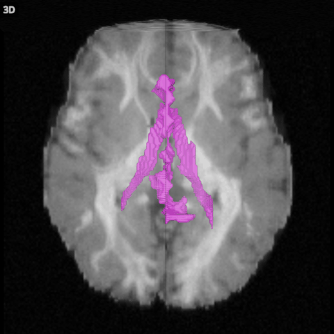

# The 3D view

The 3D view shows the whole scene in 3D: the three slices through the crosshair, a volume rendering of the main
volume, a surface for each overlay, the tractograms and the cortical surfaces.

## What it shows

The **volume rendering** draws the whole main volume as a blend in which each voxel adds a little colour and
hides a little of what is behind it. The volume's **Opacity (3D)** sets how much; at 0 the rendering is off and
only the slices are left.

**Slices**, an option in the 3D section, draws the three slices of a volume or an overlay where they are in
space. A volume's slices leave out its background, so the rendering shows around them. In an image without
negative values, the background is zero and the faint values just above it; the minimum and maximum change only
the contrast.

**Surface**, also in the 3D section, draws the surface where an overlay crosses its threshold, such as the
outline of a mask. An overlay shown as labels draws the surfaces of its chosen labels instead (see
[Parcellations](04-parcellations.md)).

Tractograms are drawn as lines or tubes (see [Tractograms](05-tractograms.md)), and cortical surfaces as shaded
meshes (see [Surfaces](13-surfaces.md)). FOD glyphs and peaks are drawn in the 2D views only.

## The camera

| Mouse or key | Does |
|---|---|
| Drag | Turns the scene |
| Scroll, or pinch | Zooms |
| Shift+A | Looks from above |
| Shift+C | Looks from the front |
| Shift+S | Looks from the side |
| Shift+R | Resets the camera |
| Double click, the corner button, or 3 | Fills the window with the 3D view, and back |

The same positions are in View > 3D camera. The camera always looks at the centre of the images.
