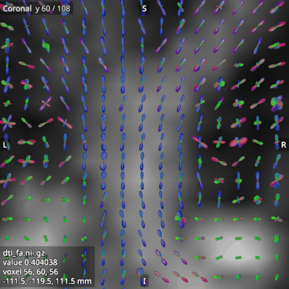

# FOD glyphs

A fibre orientation distribution (FOD) describes, for each voxel, how much fibre runs in each direction. It is
stored as a 4D image of spherical harmonic (SH) coefficients, such as MRtrix's `wmfod.mif`. Open it in the
**FODs** category. The 2D views then draw one glyph per voxel of the slice, a shape whose distance from the voxel
centre in each direction is the FOD's amplitude in that direction, coloured by direction (red left to right,
green front to back, blue up and down).

## Symmetric and asymmetric

A symmetric FOD has the same lobe at both ends of each fibre and uses the even SH degrees only, which takes
(lmax + 1)(lmax + 2) / 2 coefficients, 45 for lmax 8. An asymmetric FOD can have a lobe at one end of a fibre
only, and uses all degrees, which takes (lmax + 1)^2 coefficients, 81 for lmax 8. The viewer tells the two apart
by the number of coefficients, and refuses a file with neither number.

## Their options

- **Basis** is the SH basis of the coefficients, which the file does not record: tournier (MRtrix's basis, the
  default), descoteaux, or leemans (ExploreDTI's basis). A wrong basis gives wrong glyphs without an error.
- **Scale** sets the glyphs' size. At 1, the largest lobe reaches the edge of its voxel; with whole_image
  scaling, a lobe of the image's high amplitude does.
- **Scaling** sets what a glyph's size is relative to. With **whole_image** (the default), all glyphs are scaled
  by the image's high amplitude, the 90th percentile of the voxels' largest amplitudes, so a glyph's size shows
  its amplitude. With **per_voxel**, each glyph is scaled on its own, so round FODs look as large as sharp ones.
- **Threshold** is a share of the image's high amplitude. A voxel whose largest amplitude is below it gets no
  glyph. It starts at 0.05, which leaves out the small noise of the background.
- **Minimum anisotropy** hides the FODs that are rounder than this. Anisotropy is 0 for a round FOD and near 1
  for a sharp one, so raising the minimum hides the round FODs of grey matter and CSF.
- **Sphere detail** sets how smooth each glyph is, 8 by default. Higher is smoother and slower.
- **Colouring** colours the glyphs by direction, or in the single colour that the Colour option sets.

## One FOD, large

To look at one voxel's FOD closely, select the FOD in the scene tree and press **Show at the cursor** in its
options, or open the inspector's Cursor tab. The tab shows the FOD at the crosshair as one large, smooth glyph,
with the R/L, A/P and S/I axes, and follows the crosshair as you click around. Drag to turn it, use the wheel to
zoom, and press **Reset view** to start again.

The glyph uses the FOD's basis and colouring, but not the threshold, the minimum anisotropy or the scale, so it
always shows the whole FOD. Outside the FOD's grid it says that there is no FOD there. The tab follows the FOD
selected in the scene tree, and keeps showing it while another kind of item is selected.

## Looking closely

A detail window shows a rectangle of a 2D view on its own, large enough to see each voxel's glyph clearly. Choose
the Zoom box tool (**Z**) and drag a rectangle in a 2D view, or right-click and choose **Zoom box from here** for a
12 x 12 voxel box around the point. The rectangle snaps to the voxels of the main volume, or of the FOD when no
volume is loaded, and opens in a floating window, whose title names the FOD, the view, the slice and the size, such
as "Detail - wmfod.mif - coronal y 60 - 12 x 12 voxels". The keys stay with the main window, so you can go on
working in the views. Several detail windows can be open at once. Each one's rectangle stays outlined in its view,
and dragging the outline's edge moves the detail. Ctrl+W or Escape in a detail window closes it. When the main
volume changes, each detail keeps showing the same place, snapped to the new volume's voxels.

The detail draws the slices without smoothing, so each voxel shows as a square, and builds the FOD glyphs for the
rectangle alone, at a sphere detail of its own (12 at first, set with **Glyph detail** in its toolbar). Its
glyphs keep the FOD's basis, colouring, scale, scaling, threshold and minimum anisotropy, unlike the glyph in
the Cursor tab. **Voxel grid** draws the voxels' edges and **Scale bar** draws a bar of a round length in mm. While
**Linked** is on, the detail follows the crosshair's slice; when you turn it off, the detail keeps the slice it
shows.

**Save N x...** writes the detail's picture at 1 to 8 times the window's size, as a PNG or TIFF image. **Figure
with inset...** writes a figure for a paper: the whole view with the rectangle outlined, and the detail beside it,
with two lines joining the rectangle to the detail, on a white or a black background. From Python,
`viewer.open_detail(ViewKind.CORONAL, (i, j, 12, 12))` opens a detail of the 12 x 12 voxels from (i, j) in the
view's plane, and `viewer.save_detail` and `viewer.save_detail_figure` write the picture and the figure.
