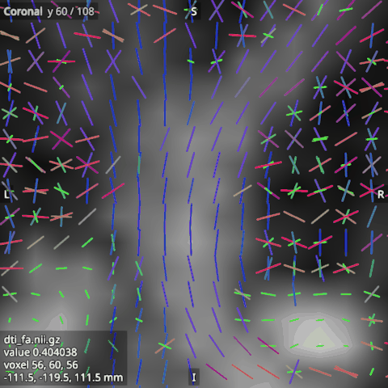

# Peaks

The peaks of an FOD (fibre orientation distribution) are the directions in which it is largest, which usually
follow the main fibre directions in each voxel. The viewer draws a peaks image, such as the one `lar peaks`
writes, in the 2D views as short lines through each voxel of the slice, one line along each peak's direction.
Open the file in the **Peaks** category.

A peaks image is 4D, with 3 volumes per peak that hold the x, y and z of the peak's direction, scaled by its
amplitude. They are NaN where a voxel has fewer peaks. A file whose number of volumes is not a multiple of 3 is
refused.

## Their options

- **Scale** sets the lines' length. At 1, the image's largest peak spans one voxel.
- **Length by amplitude**, when on, makes a line's length follow its peak's amplitude. When off, every line has
  the same length, which shows the directions alone.
- **Threshold** is a share of the image's largest amplitude, and a peak below it is not drawn.
- **Asymmetric peaks**, when on, draws each peak from the voxel centre outwards only, at half the length, so
  that a peak and its opposite together span what one line spans when the option is off. Turn it on for the
  peaks of an asymmetric FOD, where a peak and its opposite are two separate lobes; otherwise a lobe on one side
  only looks like a straight fibre. A peaks file does not say whether the signs of its directions matter, so the
  option is off for a new peaks image. From Python or an agent,
  `viewer.set_default(Category.PEAKS, OptionName.ASYMMETRIC_PEAKS, True)` before opening a file turns it on from
  the start.
- **Line width (px)** sets the lines' width on the screen.
- **Colouring** colours the lines by direction (red left to right, green front to back, blue up and down), or in
  the single colour that the Colour option sets.
