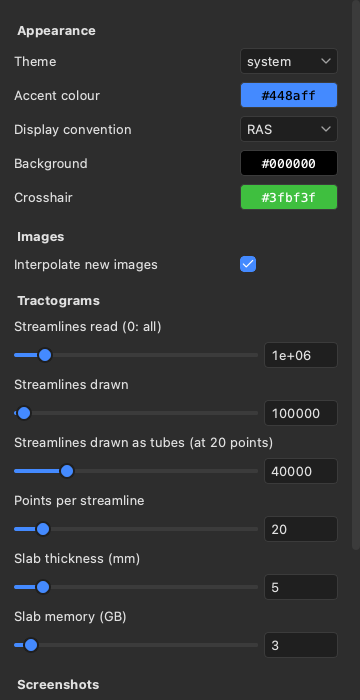

# Settings

The Settings sheet holds the viewer's preferences: its theme, how many streamlines it reads and draws, its graphics
and whether it serves agents. Open it with the gear at the right of the header or with Ctrl+, (Cmd+, on macOS). It
is a window of its own, so it can stay open beside the views. A change applies at once and is saved, so the viewer
starts with it next time.

How the views show the scene is set in the Scene tab of the inspector instead: the display convention (RAS, which
puts the subject's right on the right of the screen, or LAS, which puts it on the left; see
[The 2D views](02-2d-views.md)), the background and crosshair colours, and **Interpolate new images**, which
chooses whether images opened from now on start smooth (trilinear) or blocky (nearest voxel). These are saved with
the other settings too.

## Appearance

- **Theme** is system, light or dark. System follows the computer's light or dark mode, also when it changes.
- **Accent colour** is the one colour in the panels. It marks the selected item, the focused field, the selected
  view, checked boxes and sliders.

## Tractograms

- **Streamlines read (0: all)** is the most streamlines read from a tractogram file. A file with more streamlines
  is reduced to a random subset of this size when read. `lar bv --max-streamlines` sets its own limit.
- **Streamlines drawn** is the most streamlines drawn of each tractogram, whatever the size of its subset.
- **Streamlines drawn as tubes (at 20 points)** limits the tubes that the 3D view draws for a tractogram set to
  tubes (see [Tractograms](05-tractograms.md)). The number counts streamlines of 20 points, so streamlines with
  more points allow fewer tubes: at 200 points, a tenth as many. Past the limit, the 3D view draws lines.
- **Points per streamline** is how many points each streamline of a new tractogram keeps. More points follow the
  curves better but draw more slowly.
- **Slab thickness (mm)** is the slab that new tractograms start with. The 2D views show only the streamlines
  within this slab around the slice.
- **Slab memory (GB)** is the memory that the 2D views' slabs may take. Past it, the slabs are cut in a slower
  way.

## Graphics

**Lower resolution while moving** draws the views at half resolution while you drag or scroll, then once at full
resolution when you stop. It is off by default. Turn it on when the viewer runs on a remote display, such as over
`ssh -X`, where sending each image to your screen is the slow part.

On a computer with several GPUs, **GPU** chooses the one the viewer draws with. It applies when the viewer starts
again.

## Agents (MCP)

An agent, such as Claude Code, can drive the viewer through MCP, the Model Context Protocol;
[Driving the viewer from an agent](12-agents.md) shows how to connect one.

- **Port** is where the viewer serves agents, on this computer only. It is 8765 by default, and
  `lar bv --mcp-port` sets its own.
- **Serve agents** starts or stops the server. It is off when the viewer starts, unless the viewer was started
  with `lar bv --mcp` or `--mcp-port`.
- **URL** and **Token** are what an agent needs to connect, each with a Copy button. **New token** replaces the
  token, and agents with the old one are then refused. The token is kept in the file `mcp-token`, beside the
  settings, and only you can read it.

The settings are saved in `viewer.toml`, in `~/Library/Application Support/larmor` on macOS,
`~/.config/larmor` on Linux (or under `$XDG_CONFIG_HOME`), and `%APPDATA%\larmor` on Windows.
