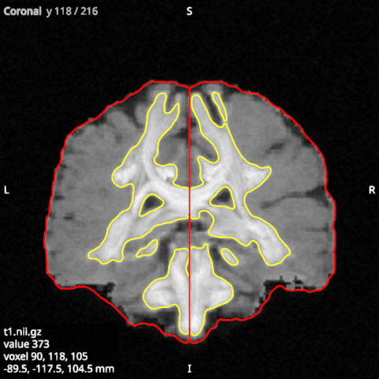
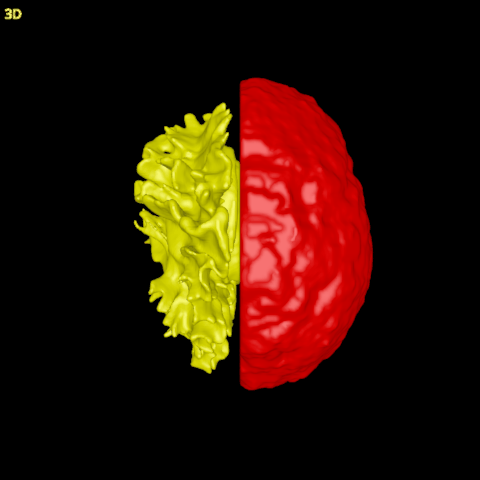

# Surfaces

Cortical surfaces, such as the white and pial surfaces FreeSurfer makes, are drawn as shaded meshes in the 3D
view and as the lines where each slice cuts them in the 2D views. Open them in the **Surfaces** category.

In the file dialog, pick the **Surfaces** file type, which lists GIfTI files (`.gii`, such as
`sub-01_hemi-L_white.surf.gii`) and FreeSurfer surfaces, which have no extension and are named by hemisphere
(`lh.white`, `lh.pial`, `rh.inflated`, ...). From a terminal, give surfaces with their own option:
`lar bv T1.nii.gz --surfaces lh.white lh.pial`.

Surfaces are placed in scanner coordinates, so they line up with the subject's T1 without any registration.

## Colours and curvature

A surface starts in a colour taken from its name: yellow for a white surface, red for a pial surface, light grey
for any other. For a FreeSurfer surface, the viewer also reads the curvature file next to it (`lh.curv` for
`lh.white`) and colours the surface by curvature, with the sulci dark and the gyri light.

- **Colour by** chooses what colours the surface. *None* gives the surface its own colour, which the Colour
  option sets. Any other choice names a set of values per vertex, which the colormap turns into colours: `curv`
  for curvature, or the values of a GIfTI file, such as thickness.
- **Colormap**, **Minimum** and **Maximum** set how the values become colours. Curvature starts in grey from -0.3
  to 0.3, and other values start with their own range. The **blue_dark_red** colormap shows a value's sign, with
  blue below zero, dark at zero and red above, when Minimum is minus Maximum. On curvature it gives the sulci one
  colour and the gyri the other.

## The 2D views

**Cut lines** draws on each 2D view the line where the slice cuts the surface, in the surface's colours, so you
can check the surface against the T1. When it is off, the surface shows only in 3D. **Line width (px)** sets the
lines' width on the screen.

## Normals

A normal is the direction a surface faces at a vertex, and the shading of the surface uses it. **Show normals**
draws the normals as short lines, the quickest check that a mesh is wound the right way. On a good surface every
normal points outward; a patch, or a whole mesh, with its faces reversed has normals that point inward. In 3D, a
lower **Opacity (3D)** shows the normals that point into the surface.

- **Normals in 3D** is how many vertices show their normal in 3D, taken at random, the same ones each time. By
  default they are every vertex of a cortical surface; a lower number gives a sparser view.
- **Spacing in 2D (mm)** is how far apart the normals are on the 2D views. There they sit on the cut lines and
  are drawn in the slice's plane, so they need the cut lines on.
- **Normal length (mm)** is the lines' length.
- **Normals colouring** and **Normals colour** colour the normals by direction (red left to right, green front
  to back, blue up and down) or in one colour.

## The medial wall

FreeSurfer closes each hemisphere with a flat patch across the midline, the medial wall, which is not cortex.
When the subject's `label/lh.cortex.label` exists, **Hide medial wall** hides the medial wall and its normals,
in 3D and on the slices. The surface itself is not changed.
