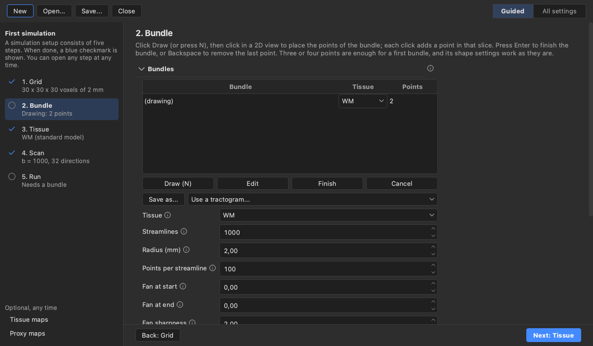
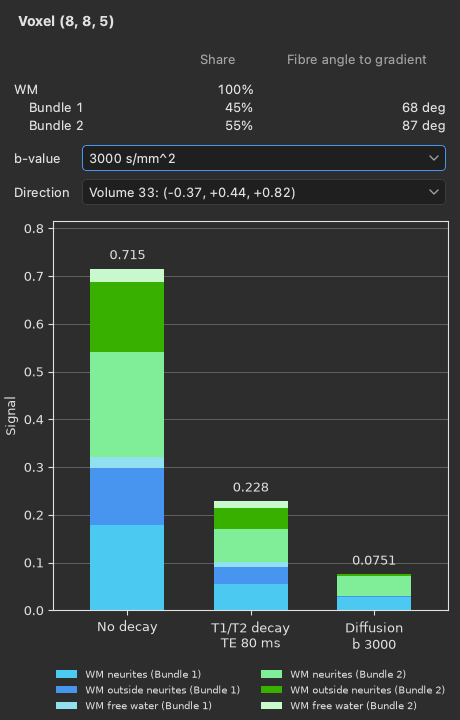

# Phantoms

A phantom is a made-up subject with a known structure, from which Larmor computes the diffusion images that a
scanner would record. Because you know what is in every voxel, a phantom lets you test a method against the truth.

The Simulate workspace edits a phantom for Larmor's simulation module. Choose **Simulate** in the switch at the
left of the header, or press **Ctrl+2**. A phantom consists of a voxel grid, tissues, fibre bundles (loaded from files
or drawn in the 2D views), tissue maps and a scanning protocol. When you run the phantom, the viewer simulates the
diffusion images and opens the results as ordinary items, which the View workspace shows in the scene tree.

## A first simulation, step by step

The panel on the left of the workspace lists the five steps of a simulation: Grid, Bundle, Tissue, Scan and Run. A
blue check mark next to a step shows that it is done, and a short line under it says where it stands, such as the
size of the grid, the number of points of the bundle being drawn, or the b-value and the number of directions of the
scan. The default grid, tissues and scan already work, so those three steps are ticked from the start, and a new
phantom needs only a bundle before it can run. Above the steps, **New** starts a phantom, **Open** reads a phantom
file or a simulation folder, and **Save** writes the phantom to a file.



The panel on the right shows the page of the step you are on: a heading, a few sentences on what the step does, and
the fields that matter for it. The rest of the step's fields are under a **More** fold at the end of the page, which
says what it holds. **Next** and **Back** move between the steps, and clicking a step in the list opens it. You can
go to any step at any time and in any order.

A first simulation follows the steps in their order.

1. Click **New** to start a phantom. It opens on the Grid step, and the grid works as it is, so click **Next**.
2. On the Bundle step, choose **Draw bundle** in the toolbar or press **N**, place three or four points in a 2D view
   and press **Enter** to finish the bundle. The new bundle is filled with the WM tissue, a standard model of white
   matter. To fill it with another tissue, choose one in the bundle's row of the bundles table.
3. The Tissue step edits the tissues themselves. You can keep them as they are.
4. On the Scan step, the default scan is a single-shell acquisition at b = 1000 s/mm^2 with 32 directions and no
   noise, which you can also keep. **Add shell** adds a shell to the table, and More holds the sequence, the timings
   and the gradient files.
5. On the Run step, **Run** starts the simulation. If no output folder is set, it first asks for a folder to save
   the results in. The results open as items when the run ends.

Under "Optional, any time", the list also links to the Signal breakdown of a voxel (see below), to the tissue maps
and the background, which a first simulation does not need, and to **All settings**. All settings opens a window
that shows every section and field of the editor at once, including the proxy maps and the phantom's Close button.
The pages and the window show the same phantom, so a change made in one shows in the other.

## Grid and tissues

The Grid step sets the voxel grid of the phantom. Type the size of a box in millimetres and a voxel size, then
click **Use this box**, or take the grid of an image you have loaded. A new phantom starts on the grid of the main
volume when there is one. The grid's box is outlined in every view while you draw; at other times, **Show the grid
box** under the Grid step's More shows or hides the outline, and a session remembers your choice.

The phantom starts with three tissues: white matter (WM), grey matter (GM) and cerebrospinal fluid (CSF). Each
tissue is either a preset whose parameters you can change, or a list of compartments that you build yourself. A
compartment is one pool of water with its own diffusion model, such as the water inside axons or the water
around them. The presets are the standard model and NODDI (neurite orientation dispersion and density imaging)
for white matter, SANDI (soma and neurite density imaging) for grey matter, and free water for CSF. NODDI spreads
its neurites around the fibre direction, and its kappa parameter sets how tightly they follow it.

In the compartment table, each row picks one of these models:

- the stick, the zeppelin, the ball, the powder-averaged stick and the sphere;
- the Watson-dispersed sticks of NODDI, which use the kappa column;
- the cylinder, which uses the radius column;
- the dot, whose water does not move;
- free water, whose share a run reports as the free-water fraction of its ground truth.

The bar below the table shows the fraction of each compartment, and the tissue is accepted only once the
fractions add up to 1. When you change a tissue, every bundle that uses it changes with it.

A tissue map gives a tissue its share of each voxel from a loaded overlay, which must hold values between 0 and 1
on the phantom's grid. The Background setting chooses the tissue that fills what is left of each voxel, or leaves
that part without signal. Only a tissue without a fibre direction, such as GM, can have a map or be the
background, because sticks, zeppelins, Watson-dispersed sticks and cylinders need the fibre direction that a
bundle gives them, while the dot, the ball, free water, the sphere and the powder-averaged stick do not.

## Drawing bundles

To draw a bundle, choose **Draw bundle** in the toolbar, click **Draw (N)** on the Bundle step, or press **N**. There are then two ways
to add control points in a 2D view, and you can mix them in one bundle. Freehand, the usual way, you press, drag
along the path the bundle should take, and let go: the stroke becomes the fewest points spaced evenly along it
whose bundle stays within about one voxel of the stroke, at most 12 of them and always its first and last, and
these are added after the points already there. Another stroke adds more points. To place control points one at a time, hold Ctrl (Cmd on macOS)
and click: each click adds a point at that place, while a Ctrl+drag still pans the view. Either way the points lie
in the view's slice, and the crosshair moves to the last one, so the other views follow it. Points outside the
grid box are left out, and the status bar says so when none is inside. A control point already placed can be
dragged to a new place in the view's plane. Scrolling still changes the slice. The bundle is drawn again from its
points as you add them. The keys below work only while you draw, so at other times they keep their usual meaning
in the scene tree and in dialogs. While you draw, a card on the Bundle step counts
the points placed and has **Finish** and **Cancel**.

| Key | What it does while drawing |
|---|---|
| **N** | Starts a new bundle; the one being drawn is finished first |
| **Enter** | Finishes the bundle |
| **Backspace** | Takes back the last stroke, or the last point placed with Ctrl+click |
| **Escape** | Stops drawing; a new bundle is dropped and an edited one is kept as it was |

Choosing another tool (V, O, B or Z) also stops drawing: the bundle is finished if it has two points, else
dropped.

A finished bundle is an ordinary tractogram in the scene tree, so all the tractogram options apply to it. Its row in
the bundles table chooses the tissue that fills it. When you select a bundle, the editor shows its shape (the number
of streamlines, the radius, the fanning, the dispersion and the seed) so that you can change it, and **Edit** brings
its points back into draw mode. The bundle keeps its place in the scene tree and its options while you edit it. You
can also make a loaded tractogram a bundle of the phantom with **Use a tractogram...**.

## Proxy maps

A full simulation takes a while, so the Proxy maps section of the All settings window can show three overlays that
follow every edit without a run. The bundle fill map shows how much of each voxel the bundles fill; its first volume
is all bundles together, followed by one volume per bundle. The tissue partition shows the share of each tissue in
each voxel, with the background last. The expected b0 map shows the signal that a run without noise would give at
b = 0, which lets you check the effect of a tissue's T2 or proton density before you run.

## Signal breakdown

The Signal breakdown panel shows how the signal of one voxel comes about. Open it with **Signal breakdown of a
voxel** under the steps or with **Ctrl+6**; it opens below the views, and it closes while the View workspace shows.
It splits the signal into the factors that the simulation multiplies together and draws them as three stacked bars,
with the total of each bar above it.

- The first bar, labelled No decay, is the water in the voxel before any decay: each tissue's share of the voxel
  times the fraction and proton density of each of its compartments.
- The second bar, labelled T1/T2 decay with the echo time, is the signal after the T1 and T2 decay at the echo
  time. For a gradient echo, T2* takes the place of T2 in both the decay and the label.
- The third bar, labelled Diffusion with the b-value, is the signal after the diffusion weighting of the chosen
  volume.

Each bar is split into the voxel's compartments, named in plain words such as WM axons, GM soma, WM neurites,
still water or CSF, and each bundle has colours of its own. When the scan has noise, a dashed line marks the
noise floor, the mean magnitude of pure noise. The legend below the chart names the compartments, and when two
bundles cross, each of its two columns lists one bundle.



Above the chart, a heading names the voxel, such as "Voxel (42, 57, 30)". Below it, a small table lists what
fills the voxel. Each tissue has a row with its share of the voxel; a tissue that leaves the voxel empty is not
listed. Under a tissue that fills bundles, each bundle has an indented row with its name from the Bundles table
and its own share of the voxel, so two crossing bundles show as two rows. The last column of a bundle's row gives
the angle between the bundle's fibres and the gradient of the volume chosen in the Direction list. At 0 deg the
fibres run along the gradient and lose the most signal to diffusion, and at 90 deg they lose the least. The
column is blank for the tissue rows and at b = 0.

The panel follows the voxel under the pointer in the 2D views. Clicking the phantom pins the panel to that voxel,
which is then outlined in every view, and **Escape** unpins it so that it follows the pointer again. You can also
right-click a voxel and choose **Signal breakdown here**, which opens the panel pinned to that voxel. The b-value
and Direction lists choose the volume of the scan that the third bar shows.

The panel updates whenever a tissue, a bundle, a tissue map or the scan changes, without running a simulation, so
the bars show at once what, for example, a longer echo time or a smaller soma radius does to the voxel. The
breakdown gives the same value as the noise-free image of a run, since both come from the same compartment
models. From Python, `larmor.simulation.signal_breakdown` computes the breakdown and
`larmor.plot.plot_signal_breakdown` draws the same chart.

## Running and saving

The Scan step sets the sequence, the echo and repetition times, the gradient timing, the shells (or a pair of bvals
and bvecs files) and the noise. **Run** (**Ctrl+R**), on the Run step or in the header, is greyed out until the
phantom can run, with the first problem as its tooltip. It asks for an output folder if none is set, and asks before
it replaces the outputs of an earlier run. The simulation then runs in the background, with its progress and a
Cancel button in the status bar and on the Run step. A cancelled run opens nothing.

The output folder has the same contents as the one that `lar simulate` writes. When the run ends, the diffusion
images open as the main volume, the tissue masks as overlays and the true fibre directions as peaks. The bundles
then refer to the streamline files in the folder, so a session saved afterwards keeps everything.

**Save** above the steps writes the phantom to a phantom file, and **Open** reads it back. From the command line,
`lar bv --phantom scene.phantom.json` opens a phantom file, and `lar bv --simulation folder` opens a simulation
folder with its phantom in the editor. A saved session also keeps the phantom, and opening the session restores
the editor. A bundle that you are still drawing is not saved with the session, so finish it first.

The same steps from Python look like this:

```python
from larmor.viewer import ProxyMap, Viewer

viewer = Viewer()
viewer.new_phantom((60, 60, 60), 2.0)
viewer.start_bundle()
for point in [(-25, 0, 0), (0, 5, 0), (25, 0, 0)]:
    viewer.add_bundle_point(point)
bundle = viewer.finish_bundle()
viewer.show_proxy(ProxyMap.FILL)
viewer.run_phantom("sim")
```
