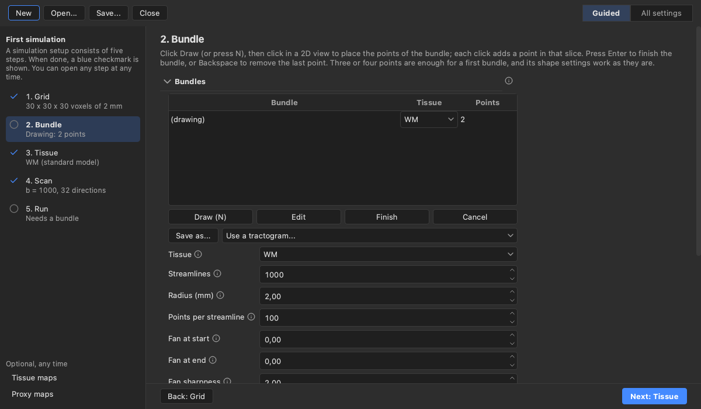
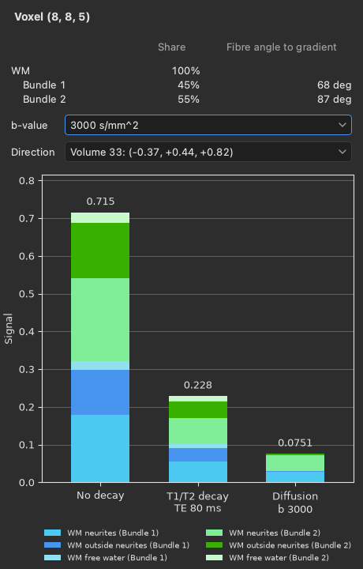

# Phantoms

A phantom is a made-up subject with a known structure, from which Larmor computes the diffusion images that a
scanner would record. Because you know what is in every voxel, a phantom lets you test a method against the truth.

The SymDWI workspace edits a phantom for Larmor's simulation module. Choose **SymDWI** in the switch at the
left of the header, or press **Ctrl+2**. A phantom consists of a voxel grid, tissues, fibre bundles (loaded from files
or drawn in the 2D views), tissue maps and a scanning protocol. When you run the phantom, the viewer simulates the
diffusion images and opens the results as ordinary items, which the View workspace shows in the scene tree.

## A first simulation, step by step

The panel on the left of the workspace lists the five steps of a simulation: Grid, Bundle, Tissue, Scan and Run. A
blue check mark next to a step shows that it is done, and a short line under it says where it stands, such as the
size of the grid, the number of points of the bundle being drawn, or the b-value and the number of directions of the
scan. The default grid, tissues and scan already work, so those three steps are ticked from the start, and a new
phantom needs only a bundle before it can run. Above the steps, **New** starts a phantom, **Open** reads a phantom
file or a simulation folder, and **Save** writes the phantom to a file. New and Open ask before they discard a
phantom that has bundles.



The panel on the right shows the page of the step you are on: a heading, a few sentences on what the step does, and
the fields that matter for it. The rest of the step's fields are under a **More** fold at the end of the page, which
says what it holds. **Next** and **Back** move between the steps, and clicking a step in the list opens it. You can
go to any step at any time and in any order.

A first simulation follows the steps in their order.

1. Click **New** to start a phantom. It opens on the Grid step, and the grid works as it is, so click **Next**.
2. On the Bundle step, choose the **Pen** in the toolbar or press **P**, drag in a 2D view along the path the bundle
   should take and press **Enter** to finish the bundle. The new bundle is filled with the WM tissue, a standard model of white
   matter. To fill it with another tissue, choose one in the bundle's row of the bundles table.
3. The Tissue step edits the tissues themselves, with their parameters under More. You can keep them as they are.
4. On the Scan step, the default scan is a single-shell acquisition at b = 1000 s/mm^2 with 32 directions and no
   noise, which you can also keep. **Add shell** adds a shell to the table, and More holds the sequence, the timings
   and the gradient files.
5. On the Run step, **Run** starts the simulation. If no output folder is set, it first asks for a folder to save
   the results in. The results open as items when the run ends.

Under "Optional", the list also links to the Signal breakdown of a voxel (see below), to the tissue maps
and the background, which a first simulation does not need, and to **All settings**. All settings opens a window
that shows every section and field of the editor at once, including the proxy maps and the phantom's Close button.
The pages and the window show the same phantom, so a change made in one shows in the other.

## Grid and tissues

The Grid step sets the voxel grid of the phantom. Type the size of a box in millimetres and a voxel size, then
click **Use this box** or go to another step, or take the grid of an image you have loaded. A size that is not a
whole number of voxels is rounded, and the step says so. A new phantom starts on the grid of the main
volume when there is one. The grid's box is outlined in every view while you draw; at other times, **Show the grid
box** under the Grid step's More shows or hides the outline, and a session remembers your choice.

The phantom starts with three tissues: white matter (WM), grey matter (GM) and cerebrospinal fluid (CSF). Each
tissue is either a preset whose parameters you can change, or a list of compartments that you build yourself. A
compartment is one pool of water with its own diffusion model, such as the water inside axons or the water
around them. The presets are the standard model and NODDI (neurite orientation dispersion and density imaging)
for white matter, SANDI (soma and neurite density imaging) for grey matter, and free water for CSF. The standard
model here differs slightly from the usual stick, zeppelin and ball model. By using a Watson stick, the simulated
signal more closely resembles a real acquisition, because it drops the assumption that all fibres in a voxel have
exactly the same direction. The standard model and NODDI both spread their sticks around the fibre direction, and
their kappa parameter sets how tightly the sticks follow it.

In the compartment table, each row picks one of these models:

- the stick, the zeppelin, the ball, the powder-averaged stick and the sphere;
- the Watson-dispersed sticks, which use the kappa column;
- the cylinder, which uses the radius column;
- the dot, whose water does not move;
- free water, whose share a run reports as the free-water fraction of its ground truth.

The bar below the table shows the fraction of each compartment, and the tissue is accepted only once the
fractions add up to 1. When you change a tissue, every bundle that uses it changes with it.

A tissue map gives a tissue its share of each voxel from a loaded overlay, which must hold values between 0 and 1
on the phantom's grid. The Background setting chooses the tissue that fills what is left of each voxel, or leaves
that part without signal. Only a tissue without a fibre direction, such as GM, can have a map or be the
background, because sticks, zeppelins, Watson-dispersed sticks and cylinders need the fibre direction that a
bundle gives them, while the dot, the ball, free water, the sphere and the powder-averaged stick do not.

## Drawing bundles

You draw and shape bundles in the 2D views with the tools in the toolbar, and the options of the tool chosen show in a
bar below it. The status bar says how the tool works. The 3D view is only for looking: a drag there turns it, whatever
the tool. A 2D view shows a bundle within its slab, 5 mm around the slice unless you change the slab, and a tool can
only take what shows. Scrolling moves the slice through depth, also during a stroke, and Ctrl+drag pans. Escape takes
back the drag going on.

**Ctrl+Z** (Cmd+Z on macOS) takes back the last change to the bundles, and **Ctrl+Shift+Z** does it again. A change is a
finished stroke or tool edit, a removed bundle, or a setting of a bundle such as its tissue, streamlines, radius, tangle
or fullness, and a drag of a slider counts as one. Finishing a bundle goes with its last stroke. This also works with
the focus on one of the bundle's fields, though a text field keeps its own undo while it has typing to take back. The
last 100 changes are kept. The tissues, the scan, the grid and the options of the items have no undo, and a new or
opened phantom starts the history again.

### The Pen

The **Pen** (**P**, or **Draw (P)** on the Bundle step) draws a bundle in two ways, which you can mix. Dragging draws a
stroke, which becomes the fewest points spaced evenly along it whose bundle stays within about one voxel of the stroke,
fewer if you are zoomed in, and at most 24. Clicking places one point at a time on the slice, so that a bundle can pass
through chosen places. Scrolling during a stroke, or between clicks, carries the path to another depth.

Where a stroke starts decides what it does:

- From empty space it starts a new bundle, and a bundle you were drawing is finished first.
- From a tip of a bundle, marked by a white ring when the pointer is over it, it lengthens that bundle. A click on a
  tip goes on from there with single points.
- From the side of a bundle it makes a branch, which leaves the bundle there and takes half of its streamlines.
- From one place on a bundle to another it redoes the stretch between, so that a stroke in another view can correct
  the depth of a path drawn in the first.

A plain click on a bundle does nothing. A click with **Ctrl** (Cmd on macOS) places a point right there even over a
bundle, while Ctrl+drag still pans. The points and the path show in pink in every view until the bundle is finished,
and the bundle is drawn again from them as they change. You can drag a point to a new place in the view's plane, and
the two end points with Ctrl held, as a plain press on an end goes on from there. Points outside the grid box are left
out, and the status bar says so when none is inside.

| Key | What it does with the Pen |
|---|---|
| **Enter** | Finishes the bundle and selects it; the Pen stays on for the next |
| **Backspace** | Takes back the last stroke or point |
| **[** and **]** | Make the radius smaller or larger; during a stroke they change it from there on along the stroke |
| **Escape** | Stops drawing; a new bundle is dropped and an edited one is kept as it was |

**Edit** on the Bundle step brings a finished bundle's points back in the same way, and choosing another tool
finishes the bundle if it has two points, or else drops it.

### The other tools

Each of these takes a bundle that shows where you press, and leaves it finished.

**Bend** (**B**) moves the place you grab in the view's plane, and the parts nearby and any branches follow. **Reach**
says how far along they follow, and at its top the whole bundle moves.

**Width** (**W**) is a soft brush. Drag out to widen the bundle at that place and in to narrow it. Which way is outwards
is settled when you press, so dragging on across the centreline keeps narrowing. Reach sets how far along it acts, up
to 200 mm, and a white line shows that stretch as you hover. **Round** changes the whole section, and **Flat**, or
Shift during a Round stroke, changes only the width you see in this view. Repeating a stroke at one place does not pile
up the rings that hold the section.

**Twist** (**T**) rolls the bundle at a place when you drag across it, one degree per pixel, and it turns back to its
old direction within Reach. Looking along a bundle, circle it instead. While this tool is on, streamlines are coloured
by their place across the bundle, so a twist shows as colours changing sides.

**Fan** (**F**) makes the streamlines of one end land on a line you draw across it. A white ring marks the end nearest
the pointer, which is settled when you press, and the slice goes to that end's depth. Drawing another line replaces the
first and leaves nothing behind. A line at right angles to the first, from another view, sets the fan's thickness. A
line across the bundle well before its end stops the bundle there. **Opens from** says where along the bundle the
streamlines start to spread.

**Erase** (**E**) removes a bundle and its branches when you click it, and cuts a bundle where you drag across it, and
the shorter part goes. It only cuts what shows in the view.

**[** and **]** change Reach with Bend, Width and Twist.

A branch shares its stem with the bundle it leaves: the viewer writes the stem into the branch's own points and section,
so a phantom file holds each as a whole path, and a branch follows the bundle it leaves when you bend or widen it. A
stem's voxels hold both bundles, which split them between themselves.

### Fullness, tangle and true-size tubes

A selected bundle's row in the bundles table chooses the tissue that fills it, and the form below shows its shape.
**Fullness** sets how much of the voxels the bundle fills. A plain tube of one radius fills the voxels inside it, and
the field says so, until you move the slider. Then, as for any bundle that has changed section or has a fan, its
streamlines fill by their length: each stands for a share of the section, and the unit of the slider is the bundle's
median section divided by its number of streamlines. At the default of 3 the core fills up and the edge is soft, and at
1 the streamlines together hold the section. The fullness stays as you reshape the bundle. **Default** goes back, which
for a plain tube means filling its tube again.

**Tangle** makes the streamlines lose their places: each slides to another place across the bundle over the distance
you set, which spreads the directions in a voxel more the shorter it is. A distance too short for the bundle's points
is raised to the shortest they can show, and the field says so.

**True-size tubes in 3D** draws the streamlines in the 3D view as tubes of the cross-section each one stands for, of
radius sqrt(a / pi), where a is the area that gives the fill. The field shows that radius, which follows Fullness. It
also lies outside the range of the tube radius option when it needs to, between 0.005 and 20 mm. Since a plain tube
has no such area, its tubes show its section shared out evenly among its streamlines, which together then hold the
tube's volume. A bundle with too many streamlines for the tube limit in Settings shows lines instead, as the status
bar says, and a subset shows that share of them, so it looks emptier than it fills.

A finished bundle is an ordinary tractogram in the scene tree, so all the tractogram options apply to it. Under More,
**Streamline area** gives the same fill in mm^2 per streamline. The bundle keeps its place in the scene tree and its
options while you edit it. You can also make a loaded tractogram a bundle of the phantom with **Use a tractogram...**,
and its **Densest fill** sets how full its densest voxels are. To remove bundles, select their rows in the bundles table
and click **Remove** or press **Delete**; several rows can be selected at once, as in the scene tree. A branch whose
parent you remove this way stays, with its stem.

## Proxy maps

A full simulation takes a while, so the Proxy maps section of the All settings window can show three overlays that
follow every edit without a run. The bundle fill map shows how much of each voxel the bundles fill; its first volume
is all bundles together, followed by one volume per bundle. The tissue partition shows the share of each tissue in
each voxel, with the background last. The expected b0 map shows the signal that a run without noise would give at
b = 0, which lets you check the effect of a tissue's T2 or proton density before you run.

## Signal breakdown

The Signal breakdown panel shows how the signal of one voxel comes about. Open it with **Signal breakdown of a
voxel** under the steps or with **Ctrl+6**; it opens below the views, and it closes while the View workspace shows.
It splits the signal into the factors that the simulation multiplies together and draws them as three stacked bars,
with the total of each bar above it.

- The first bar, labelled No decay, is the water in the voxel before any decay: each tissue's share of the voxel
  times the fraction and proton density of each of its compartments.
- The second bar, labelled T1/T2 decay with the echo time, is the signal after the T1 and T2 decay at the echo
  time. For a gradient echo, T2* takes the place of T2 in both the decay and the label.
- The third bar, labelled Diffusion with the b-value, is the signal after the diffusion weighting of the chosen
  volume.

Each bar is split into the voxel's compartments, named in plain words such as WM neurites, GM soma, still
water or CSF, and each bundle has colours of its own. When the scan has noise, a dashed line marks the
noise floor, the mean magnitude of pure noise. The legend below the chart names the compartments, and when two
bundles cross, each of its two columns lists one bundle.



Above the chart, a heading names the voxel, such as "Voxel (42, 57, 30)". Below it, a small table lists what
fills the voxel. Each tissue has a row with its share of the voxel; a tissue that leaves the voxel empty is not
listed. Under a tissue that fills bundles, each bundle has an indented row with its name from the Bundles table
and its own share of the voxel, so two crossing bundles show as two rows. The last column of a bundle's row gives
the angle between the bundle's fibres and the gradient of the volume chosen in the Direction list. At 0 deg the
fibres run along the gradient and lose the most signal to diffusion, and at 90 deg they lose the least. The
column is blank for the tissue rows and at b = 0.

The panel follows the voxel under the pointer in the 2D views. Clicking the phantom pins the panel to that voxel,
which is then outlined in every view, and **Escape** unpins it so that it follows the pointer again. You can also
right-click a voxel and choose **Signal breakdown here**, which opens the panel pinned to that voxel. The b-value
and Direction lists choose the volume of the scan that the third bar shows.

The panel updates whenever a tissue, a bundle, a tissue map or the scan changes, without running a simulation, so
the bars show at once what, for example, a longer echo time or a smaller soma radius does to the voxel. The
breakdown gives the same value as the noise-free image of a run, since both come from the same compartment
models. From Python, `larmor.simulation.signal_breakdown` computes the breakdown and
`larmor.plot.plot_signal_breakdown` draws the same chart.

## Running and saving

The Scan step sets the sequence, the echo and repetition times, the gradient timing, the shells (or a pair of bvals
and bvecs files) and the noise. A bvecs file is read in the FSL frame, as `lar simulate` reads it, unless you choose
the world frame next to the file. A phantom file that holds a gradient table keeps that table exactly, and the Scan
step says that the directions come from the file; editing the shells replaces it with directions made from the
shells. The SNR is that of a voxel full of WM at b = 0, or of the noise reference tissue chosen under More. A run of
a phantom file gives the same images as `lar simulate` with the noise seed of the Scan step.

**Run** (**Ctrl+R**), on the Run step or in the header, is greyed out until the phantom can run, with the first
problem as its tooltip; a bundle that is being drawn or edited must be finished or cancelled first, though the Pen
waiting for its next bundle does not stop it. It asks for an
output folder if none is set, and asks before it replaces the outputs of an earlier run or writes into a folder
that holds other files. The simulation then runs in the background, with its progress and a Cancel button in the
status bar and on the Run step. Once the files are being saved, the run can no longer be cancelled. A message
says when the run has finished or failed; a cancelled run opens nothing.

The output folder has the same contents as the one that `lar simulate` writes. When the run ends, the diffusion
images open as the main volume, the tissue masks as overlays and the true fibre directions as peaks. The bundles
then refer to the streamline files in the folder, so a session saved afterwards keeps everything.

**Save** above the steps writes the phantom to a phantom file, and **Open** reads it back. A loaded tractogram or
tissue map that was registered when it was opened, or read as a subset of its streamlines, is written next to the
phantom file as the viewer shows it, so the file reopens it in the same place. From the command line,
`lar bv --phantom scene.phantom.json` opens a phantom file, and `lar bv --simulation folder` opens a simulation
folder with its phantom in the editor. A saved session also keeps the phantom, and opening the session restores
the editor. A bundle that you are still drawing is not saved with the session, so finish it first. A phantom file or a
session from an earlier version opens with its fan read as rings of the same width, and without its dispersion, and
the log says so.

The same steps from Python look like this:

```python
from larmor.viewer import ProxyMap, Viewer

viewer = Viewer()
viewer.new_phantom((60, 60, 60), 2.0)
viewer.start_bundle()
for point in [(-25, 0, 0), (0, 5, 0), (25, 0, 0)]:
    viewer.add_bundle_point(point)
bundle = viewer.finish_bundle()
viewer.show_proxy(ProxyMap.FILL)
viewer.run_phantom("sim")
```
